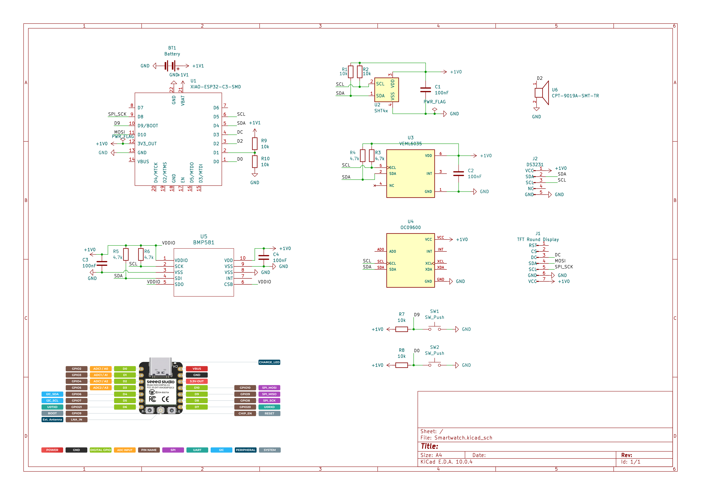
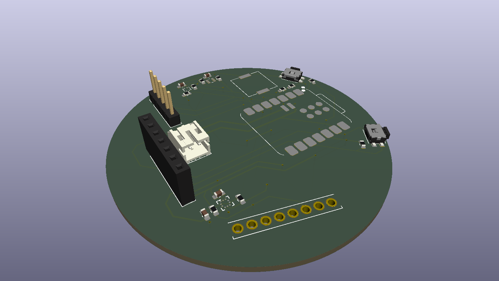
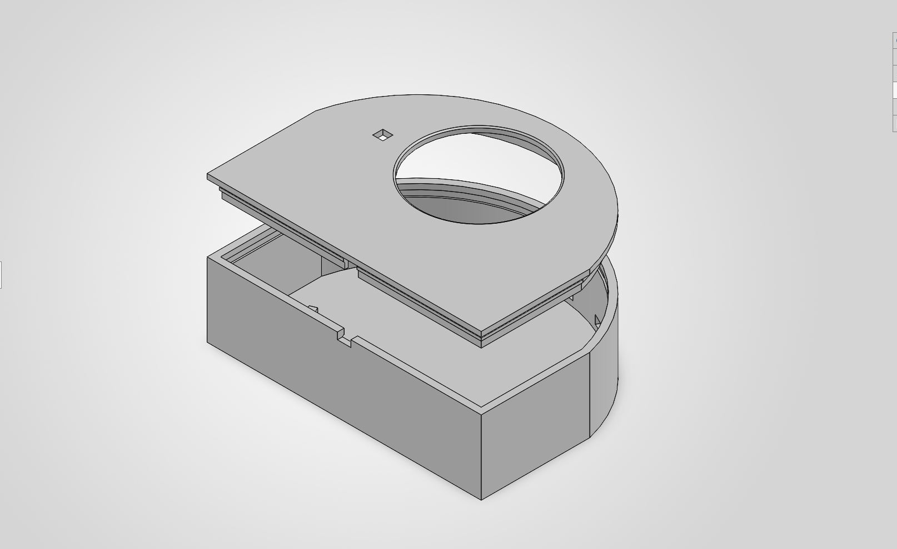
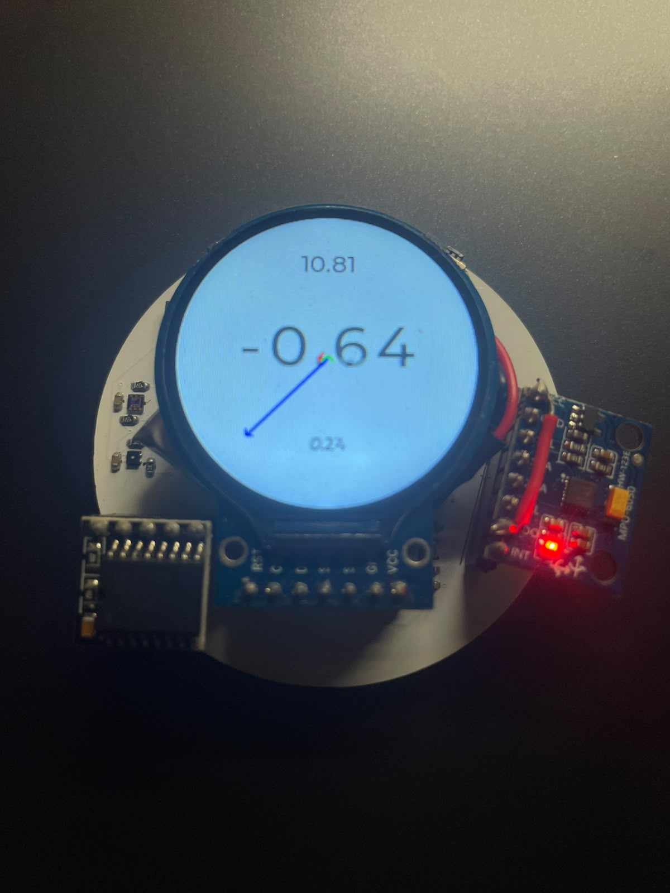

# Smartch
This repository contains all the files for the smartwatch and it is participating in the Stardance Challenge by Hack Club.

## Demo Video

# Bill of Materials
Components are bought from DigiKey, AliExpress and Amazon
- XIAO ESP32C3 (main processor)
- 450mAh LiPo Battery with PH 2.0 mm JST Connector
- PH 2.0 mm JST Connector
- 4 x 100nF 0603_1608 Capacitors (DigiKey part number: 1276-1005-1-ND)
- 1.28 inch Round TFT Display (with pin sockets)
- DS3231 RTC Module (with pin headers)
- 6 x 10k 0603_1608 Resistors (DigiKey part number: 311-10.0KHRCT-ND)
- 4 x 4.7k 0603_1608 Resistors (DigiKey part number: 311-4.70KHRCT-ND)
- 2 x Tactile Switches (DigiKey part number: P10851SCT-ND)
- SMD SHT40 Temp&Hum Sensor (DigiKey part number: 1649-SHT40-AD1F-R2CT-ND)
- SMD VEML6035 Ambient Light Sensor (DigiKey part number: VEML6035CT-ND)
- MPU6050 (with pin sockets)
- SMD BMP581 Air Pressure Sensor (DigiKey part number: 828-BMP581CT-ND)
- SMD CPT-9019A-SMT-TR Passive Buzzer (DigiKey part number: 2223-CPT-9019A-SMT-TRCT-ND)

## KiCad Designs
## Schematic

## PCB
I used JLCPCB, but you can you any other PCB fabrication services. If want to solder components by yourself rather than assembly option, order a stencil and solder paste as well.

## Case Design
I 3D printed a case designed on SolidWorks. The PCB sits on the base of the case and the lid snaps into the body. When you are modifying the SolidWorks file, be careful because I am using a student version, so it will leave a watermark. If you would like to 3D print it, you can use the STL file instead.

# Core Feature
This smartwatch uses LVGL graphics library to develop user interface.

## Current Features
1. Uses DS3231 RTC module, keeping time reliably even when the battery is dead.
2. Basic features in a clock app, such as stopwatch, timer and time adjustment.
3. Uses SHT40 sensor to log temperature on a graph.
4. Accelerometer & gyroscope readings and visualization using MPU6050.
5. Air pressure and altitude readings from BMP581.

## Features for Future Version
1. Connect to the phone via Bluetooth to receive data such as weather, message, and news.
2. Battery voltage reading
